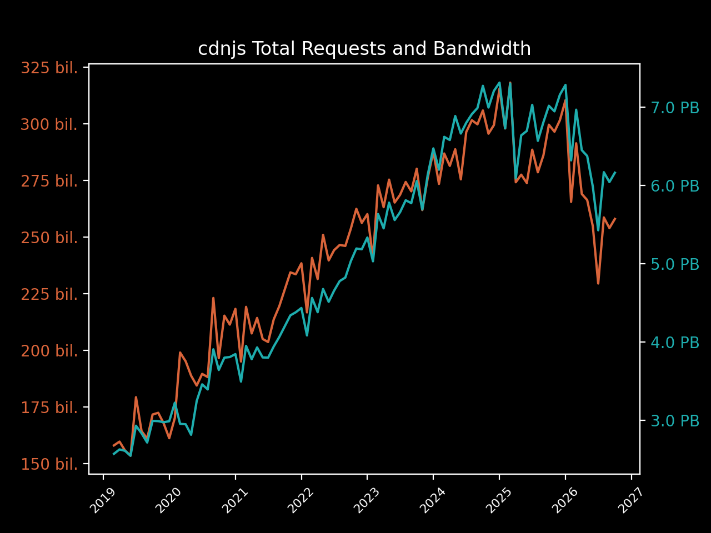
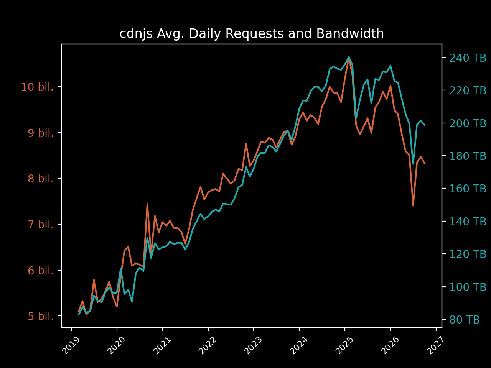
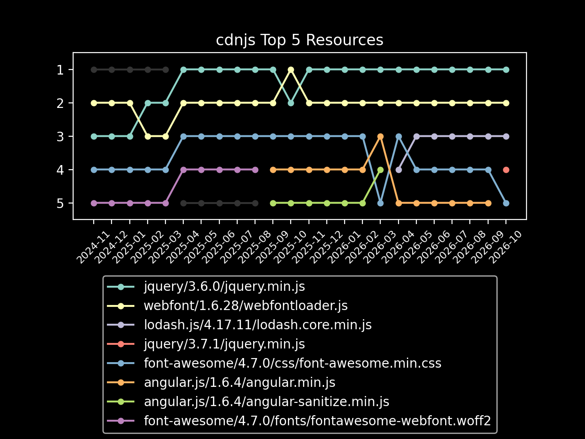
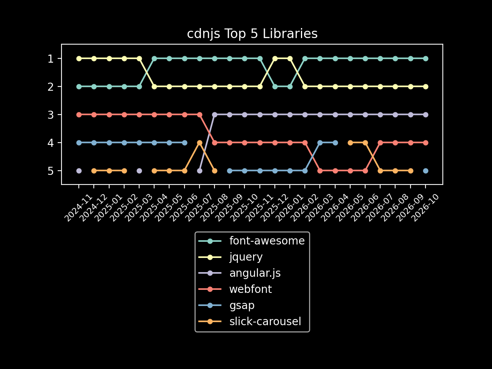

# cdnjs October 2026 Usage Stats

Information provided directly by Cloudflare for the `cdnjs.cloudflare.com` domain. ⛅️

- [Key highlights](#key-highlights)
  - [Library highlights](#library-highlights)
- [Total number of requests](#total-number-of-requests)
- [Total bandwidth usage](#total-bandwidth-usage)
- [Top 100 requested resources](#top-100-requested-resources)

## Key highlights

- cdnjs served **over 258 billion requests** in October 2026. 🖥
- cdnjs used **a massive consumption of 6.16 PB of data** to serve these requests this month. 📤
- That works out to **nearly 199 TB of data and 8.3 billion requests each day** (averaged). 🤯
- In October, **each request to cdnjs used only 23.86 KB of data on average**. 🔍
 
### Library highlights

- The top libraries overall (in the top 100 assets) this month were font-awesome, jquery,
  and angular.js.
  - Across the 30.12 billion requests for font-awesome,
    1,633.81 TB of bandwidth was consumed.
  - jquery received 20.48 billion requests and consumed 548.65 TB
    of bandwidth, with angular.js assets in the top 100 getting 11.73 billion requests and
    using 142.77 TB of bandwidth to be served.
  - webfont came in 4th this month with 5.97 billion requests, and
    gsap in 5th with 5.18 billion.
- The top asset on the CDN this month was jquery.min.js from version 3.6.0 of
  jquery, reaching a total of 10.64 billion requests and using 283.32 TB
  of bandwidth to serve the file.
  - webfont (1.6.28/webfontloader.js) came in second with
    5.97 billion requests, followed by lodash.js
    (4.17.11/lodash.core.min.js) with 4.94 billion requests.

| Total Requests & Bandwidth | Avg. Daily Requests & Bandwidth |
|---|---|
|  |  |

| Top 5 Resources | Top 5 Libraries |
|---|---|
|  |  |

## Total number of requests

> The first important stat that we are given is the total number of requests sent to cdnjs.cloudflare.com.
> 
> Cloudflare provides this number to us at a 1% sample for the whole month, giving 2,581,163,657 at 1%.

When multiplied up to 100%, this results in cdnjs serving approximately 258,116,365,700 requests in October.

**Over 258 billion requests or roughly 8.3 billion requests each day of October**. 📈

## Total bandwidth usage

> Another great stat that Cloudflare has given us again is the bandwidth usage for the cdnjs.cloudflare.com domain.
> 
> This number, like total requests, is provided at a 1% sample for the month and in gigabytes: 61,595.57 GB.

When multiplied up to be 100%, this produces the estimate of 6,159,557.0 GB of bandwidth used for this month by
 cdnjs, or 6.16 PB.

**This gives cdnjs a massive bandwidth consumption of 6.16 petabytes of data for requests this month**. 🤯

## Top 100 requested resources

> These are provided at a 1% sample for the whole of October.
> Bandwidth is measured in gigabytes.
> This data, as well as previous months' data, is available in the SQLite data.db file.

| # | Requests | Bandwidth | cdnjs Resource URL |
|---|----------|-----------|--------------------|
| 1  | 106,425,207 | 2,833.16 | [cdnjs.cloudflare.com/ajax/libs/jquery/3.6.0/jquery.min.js](https://cdnjs.cloudflare.com/ajax/libs/jquery/3.6.0/jquery.min.js)                                                           |
| 2  | 59,744,881  |   300.75 | [cdnjs.cloudflare.com/ajax/libs/webfont/1.6.28/webfontloader.js](https://cdnjs.cloudflare.com/ajax/libs/webfont/1.6.28/webfontloader.js)                                                 |
| 3  | 49,428,235  |   620.93 | [cdnjs.cloudflare.com/ajax/libs/lodash.js/4.17.11/lodash.core.min.js](https://cdnjs.cloudflare.com/ajax/libs/lodash.js/4.17.11/lodash.core.min.js)                                       |
| 4  | 40,922,870  | 1,076.87 | [cdnjs.cloudflare.com/ajax/libs/jquery/3.7.1/jquery.min.js](https://cdnjs.cloudflare.com/ajax/libs/jquery/3.7.1/jquery.min.js)                                                           |
| 5  | 39,197,964  |   248.56 | [cdnjs.cloudflare.com/ajax/libs/font-awesome/4.7.0/css/font-awesome.min.css](https://cdnjs.cloudflare.com/ajax/libs/font-awesome/4.7.0/css/font-awesome.min.css)                         |
| 6  | 30,537,449  |   769.12 | [cdnjs.cloudflare.com/ajax/libs/angular.js/1.6.4/angular.min.js](https://cdnjs.cloudflare.com/ajax/libs/angular.js/1.6.4/angular.min.js)                                                 |
| 7  | 30,512,975  |    59.24 | [cdnjs.cloudflare.com/ajax/libs/angular.js/1.6.4/angular-sanitize.min.js](https://cdnjs.cloudflare.com/ajax/libs/angular.js/1.6.4/angular-sanitize.min.js)                               |
| 8  | 29,614,280  |   293.39 | [cdnjs.cloudflare.com/ajax/libs/fingerprintjs2/2.1.2/fingerprint2.min.js](https://cdnjs.cloudflare.com/ajax/libs/fingerprintjs2/2.1.2/fingerprint2.min.js)                               |
| 9  | 22,414,602  | 1,621.04 | [cdnjs.cloudflare.com/ajax/libs/font-awesome/4.7.0/fonts/fontawesome-webfont.woff2](https://cdnjs.cloudflare.com/ajax/libs/font-awesome/4.7.0/fonts/fontawesome-webfont.woff2)           |
| 10 | 21,412,494  |    40.13 | [cdnjs.cloudflare.com/ajax/libs/jquery-mousewheel/3.1.13/jquery.mousewheel.min.js](https://cdnjs.cloudflare.com/ajax/libs/jquery-mousewheel/3.1.13/jquery.mousewheel.min.js)             |
| 11 | 18,756,946  |   371.41 | [cdnjs.cloudflare.com/ajax/libs/font-awesome/6.4.0/css/all.min.css](https://cdnjs.cloudflare.com/ajax/libs/font-awesome/6.4.0/css/all.min.css)                                           |
| 12 | 18,619,509  |   347.03 | [cdnjs.cloudflare.com/ajax/libs/font-awesome/6.5.2/css/all.min.css](https://cdnjs.cloudflare.com/ajax/libs/font-awesome/6.5.2/css/all.min.css)                                           |
| 13 | 18,195,737  |   339.99 | [cdnjs.cloudflare.com/ajax/libs/font-awesome/6.5.1/css/all.min.css](https://cdnjs.cloudflare.com/ajax/libs/font-awesome/6.5.1/css/all.min.css)                                           |
| 14 | 16,750,263  |   489.68 | [cdnjs.cloudflare.com/ajax/libs/jquery/1.12.4/jquery.min.js](https://cdnjs.cloudflare.com/ajax/libs/jquery/1.12.4/jquery.min.js)                                                         |
| 15 | 15,840,929  | 2,318.32 | [cdnjs.cloudflare.com/ajax/libs/font-awesome/6.5.2/webfonts/fa-solid-900.woff2](https://cdnjs.cloudflare.com/ajax/libs/font-awesome/6.5.2/webfonts/fa-solid-900.woff2)                   |
| 16 | 14,728,176  |    62.13 | [cdnjs.cloudflare.com/ajax/libs/jquery-migrate/1.4.1/jquery-migrate.min.js](https://cdnjs.cloudflare.com/ajax/libs/jquery-migrate/1.4.1/jquery-migrate.min.js)                           |
| 17 | 14,406,898  |   482.57 | [cdnjs.cloudflare.com/ajax/libs/angular.js/1.2.22/angular.min.js](https://cdnjs.cloudflare.com/ajax/libs/angular.js/1.2.22/angular.min.js)                                               |
| 18 | 13,776,512  |   148.94 | [cdnjs.cloudflare.com/ajax/libs/font-awesome/5.15.4/css/all.min.css](https://cdnjs.cloudflare.com/ajax/libs/font-awesome/5.15.4/css/all.min.css)                                         |
| 19 | 13,520,068  |   106.53 | [cdnjs.cloudflare.com/ajax/libs/angular-ui-utils/0.1.1/angular-ui-utils.min.js](https://cdnjs.cloudflare.com/ajax/libs/angular-ui-utils/0.1.1/angular-ui-utils.min.js)                   |
| 20 | 13,461,984  |    99.13 | [cdnjs.cloudflare.com/ajax/libs/angular-ui-router/0.2.10/angular-ui-router.min.js](https://cdnjs.cloudflare.com/ajax/libs/angular-ui-router/0.2.10/angular-ui-router.min.js)             |
| 21 | 13,402,770  |   357.88 | [cdnjs.cloudflare.com/ajax/libs/jquery/3.3.1/jquery.min.js](https://cdnjs.cloudflare.com/ajax/libs/jquery/3.3.1/jquery.min.js)                                                           |
| 22 | 13,395,788  |    17.74 | [cdnjs.cloudflare.com/ajax/libs/angular.js/1.2.22/angular-cookies.min.js](https://cdnjs.cloudflare.com/ajax/libs/angular.js/1.2.22/angular-cookies.min.js)                               |
| 23 | 13,393,061  |    39.33 | [cdnjs.cloudflare.com/ajax/libs/angular.js/1.2.22/angular-sanitize.min.js](https://cdnjs.cloudflare.com/ajax/libs/angular.js/1.2.22/angular-sanitize.min.js)                             |
| 24 | 13,377,260  |   327.63 | [cdnjs.cloudflare.com/ajax/libs/gsap/3.12.2/gsap.min.js](https://cdnjs.cloudflare.com/ajax/libs/gsap/3.12.2/gsap.min.js)                                                                 |
| 25 | 13,286,024  |    23.47 | [cdnjs.cloudflare.com/ajax/libs/angular-ui/0.4.0/angular-ui-ieshiv.js](https://cdnjs.cloudflare.com/ajax/libs/angular-ui/0.4.0/angular-ui-ieshiv.js)                                     |
| 26 | 13,228,638  |    23.90 | [cdnjs.cloudflare.com/ajax/libs/angular-dynamic-locale/0.1.27/tmhDynamicLocale.min.js](https://cdnjs.cloudflare.com/ajax/libs/angular-dynamic-locale/0.1.27/tmhDynamicLocale.min.js)     |
| 27 | 13,176,049  | 1,846.17 | [cdnjs.cloudflare.com/ajax/libs/font-awesome/6.4.0/webfonts/fa-solid-900.woff2](https://cdnjs.cloudflare.com/ajax/libs/font-awesome/6.4.0/webfonts/fa-solid-900.woff2)                   |
| 28 | 13,054,383  |   470.94 | [cdnjs.cloudflare.com/ajax/libs/html2canvas/1.4.1/html2canvas.min.js](https://cdnjs.cloudflare.com/ajax/libs/html2canvas/1.4.1/html2canvas.min.js)                                       |
| 29 | 12,857,429  | 1,878.89 | [cdnjs.cloudflare.com/ajax/libs/font-awesome/6.5.1/webfonts/fa-solid-900.woff2](https://cdnjs.cloudflare.com/ajax/libs/font-awesome/6.5.1/webfonts/fa-solid-900.woff2)                   |
| 30 | 12,562,818  |   175.33 | [cdnjs.cloudflare.com/ajax/libs/crypto-js/4.1.1/crypto-js.min.js](https://cdnjs.cloudflare.com/ajax/libs/crypto-js/4.1.1/crypto-js.min.js)                                               |
| 31 | 11,493,001  |   111.27 | [cdnjs.cloudflare.com/ajax/libs/slick-carousel/1.8.1/slick.min.js](https://cdnjs.cloudflare.com/ajax/libs/slick-carousel/1.8.1/slick.min.js)                                             |
| 32 | 11,312,129  |    16.44 | [cdnjs.cloudflare.com/ajax/libs/jquery-cookie/1.4.1/jquery.cookie.min.js](https://cdnjs.cloudflare.com/ajax/libs/jquery-cookie/1.4.1/jquery.cookie.min.js)                               |
| 33 | 11,085,605  |    51.17 | [cdnjs.cloudflare.com/ajax/libs/angular.js/1.2.22/angular-animate.min.js](https://cdnjs.cloudflare.com/ajax/libs/angular.js/1.2.22/angular-animate.min.js)                               |
| 34 | 10,998,103  |   294.98 | [cdnjs.cloudflare.com/ajax/libs/jquery/3.5.1/jquery.min.js](https://cdnjs.cloudflare.com/ajax/libs/jquery/3.5.1/jquery.min.js)                                                           |
| 35 | 10,950,380  |   273.38 | [cdnjs.cloudflare.com/ajax/libs/gsap/3.12.5/gsap.min.js](https://cdnjs.cloudflare.com/ajax/libs/gsap/3.12.5/gsap.min.js)                                                                 |
| 36 | 9,811,816   |   240.73 | [cdnjs.cloudflare.com/ajax/libs/font-awesome/6.5.2/webfonts/fa-regular-400.woff2](https://cdnjs.cloudflare.com/ajax/libs/font-awesome/6.5.2/webfonts/fa-regular-400.woff2)               |
| 37 | 9,616,316   |    49.68 | [cdnjs.cloudflare.com/ajax/libs/animate.css/4.1.1/animate.min.css](https://cdnjs.cloudflare.com/ajax/libs/animate.css/4.1.1/animate.min.css)                                             |
| 38 | 9,307,549   |   167.15 | [cdnjs.cloudflare.com/ajax/libs/font-awesome/6.7.2/css/all.min.css](https://cdnjs.cloudflare.com/ajax/libs/font-awesome/6.7.2/css/all.min.css)                                           |
| 39 | 9,183,506   |   169.93 | [cdnjs.cloudflare.com/ajax/libs/font-awesome/6.4.2/css/all.min.css](https://cdnjs.cloudflare.com/ajax/libs/font-awesome/6.4.2/css/all.min.css)                                           |
| 40 | 9,038,679   |    63.92 | [cdnjs.cloudflare.com/ajax/libs/nosleep/0.12.0/NoSleep.min.js](https://cdnjs.cloudflare.com/ajax/libs/nosleep/0.12.0/NoSleep.min.js)                                                     |
| 41 | 8,963,088   |   168.75 | [cdnjs.cloudflare.com/ajax/libs/font-awesome/6.5.0/css/all.min.css](https://cdnjs.cloudflare.com/ajax/libs/font-awesome/6.5.0/css/all.min.css)                                           |
| 42 | 8,928,135   |    41.03 | [cdnjs.cloudflare.com/ajax/libs/compressorjs/1.2.1/compressor.min.js](https://cdnjs.cloudflare.com/ajax/libs/compressorjs/1.2.1/compressor.min.js)                                       |
| 43 | 8,590,629   |    10.99 | [cdnjs.cloudflare.com/ajax/libs/slick-carousel/1.8.1/slick.min.css](https://cdnjs.cloudflare.com/ajax/libs/slick-carousel/1.8.1/slick.min.css)                                           |
| 44 | 8,572,362   |   135.07 | [cdnjs.cloudflare.com/ajax/libs/font-awesome/6.0.0/css/all.min.css](https://cdnjs.cloudflare.com/ajax/libs/font-awesome/6.0.0/css/all.min.css)                                           |
| 45 | 8,493,494   |   127.08 | [cdnjs.cloudflare.com/ajax/libs/font-awesome/6.0.0-beta3/css/all.min.css](https://cdnjs.cloudflare.com/ajax/libs/font-awesome/6.0.0-beta3/css/all.min.css)                               |
| 46 | 8,313,200   |   250.79 | [cdnjs.cloudflare.com/ajax/libs/gsap/latest/TweenMax.min.js](https://cdnjs.cloudflare.com/ajax/libs/gsap/latest/TweenMax.min.js)                                                         |
| 47 | 8,268,795   |   608.44 | [cdnjs.cloudflare.com/ajax/libs/font-awesome/5.15.4/webfonts/fa-solid-900.woff2](https://cdnjs.cloudflare.com/ajax/libs/font-awesome/5.15.4/webfonts/fa-solid-900.woff2)                 |
| 48 | 8,041,720   |    83.63 | [cdnjs.cloudflare.com/ajax/libs/OwlCarousel2/2.3.4/owl.carousel.min.js](https://cdnjs.cloudflare.com/ajax/libs/OwlCarousel2/2.3.4/owl.carousel.min.js)                                   |
| 49 | 7,918,177   |   215.73 | [cdnjs.cloudflare.com/ajax/libs/jquery/3.4.1/jquery.min.js](https://cdnjs.cloudflare.com/ajax/libs/jquery/3.4.1/jquery.min.js)                                                           |
| 50 | 7,273,890   |    12.38 | [cdnjs.cloudflare.com/ajax/libs/OwlCarousel2/2.3.4/assets/owl.carousel.min.css](https://cdnjs.cloudflare.com/ajax/libs/OwlCarousel2/2.3.4/assets/owl.carousel.min.css)                   |
| 51 | 7,116,378   |    26.21 | [cdnjs.cloudflare.com/ajax/libs/js-sha256/0.9.0/sha256.min.js](https://cdnjs.cloudflare.com/ajax/libs/js-sha256/0.9.0/sha256.min.js)                                                     |
| 52 | 6,929,331   |    99.12 | [cdnjs.cloudflare.com/ajax/libs/crypto-js/4.0.0/crypto-js.min.js](https://cdnjs.cloudflare.com/ajax/libs/crypto-js/4.0.0/crypto-js.min.js)                                               |
| 53 | 6,596,444   |    68.33 | [cdnjs.cloudflare.com/ajax/libs/slick-carousel/1.9.0/slick.min.js](https://cdnjs.cloudflare.com/ajax/libs/slick-carousel/1.9.0/slick.min.js)                                             |
| 54 | 6,524,428   |     9.91 | [cdnjs.cloudflare.com/ajax/libs/slick-carousel/1.8.1/slick-theme.min.css](https://cdnjs.cloudflare.com/ajax/libs/slick-carousel/1.8.1/slick-theme.min.css)                               |
| 55 | 6,346,497   |   937.49 | [cdnjs.cloudflare.com/ajax/libs/font-awesome/6.7.2/webfonts/fa-solid-900.woff2](https://cdnjs.cloudflare.com/ajax/libs/font-awesome/6.7.2/webfonts/fa-solid-900.woff2)                   |
| 56 | 6,267,569   |    35.66 | [cdnjs.cloudflare.com/ajax/libs/postscribe/2.0.8/postscribe.min.js](https://cdnjs.cloudflare.com/ajax/libs/postscribe/2.0.8/postscribe.min.js)                                           |
| 57 | 5,962,107   |    42.65 | [cdnjs.cloudflare.com/ajax/libs/popper.js/1.14.7/umd/popper.min.js](https://cdnjs.cloudflare.com/ajax/libs/popper.js/1.14.7/umd/popper.min.js)                                           |
| 58 | 5,922,780   |   133.82 | [cdnjs.cloudflare.com/ajax/libs/gsap/3.10.4/gsap.min.js](https://cdnjs.cloudflare.com/ajax/libs/gsap/3.10.4/gsap.min.js)                                                                 |
| 59 | 5,883,552   |   823.98 | [cdnjs.cloudflare.com/ajax/libs/font-awesome/6.4.2/webfonts/fa-solid-900.woff2](https://cdnjs.cloudflare.com/ajax/libs/font-awesome/6.4.2/webfonts/fa-solid-900.woff2)                   |
| 60 | 5,775,952   |   107.03 | [cdnjs.cloudflare.com/ajax/libs/font-awesome/6.6.0/css/all.min.css](https://cdnjs.cloudflare.com/ajax/libs/font-awesome/6.6.0/css/all.min.css)                                           |
| 61 | 5,740,105   |   838.79 | [cdnjs.cloudflare.com/ajax/libs/font-awesome/6.5.0/webfonts/fa-solid-900.woff2](https://cdnjs.cloudflare.com/ajax/libs/font-awesome/6.5.0/webfonts/fa-solid-900.woff2)                   |
| 62 | 5,637,064   |   617.89 | [cdnjs.cloudflare.com/ajax/libs/font-awesome/6.5.1/webfonts/fa-brands-400.woff2](https://cdnjs.cloudflare.com/ajax/libs/font-awesome/6.5.1/webfonts/fa-brands-400.woff2)                 |
| 63 | 5,551,502   |   649.76 | [cdnjs.cloudflare.com/ajax/libs/font-awesome/6.0.0-beta3/webfonts/fa-solid-900.woff2](https://cdnjs.cloudflare.com/ajax/libs/font-awesome/6.0.0-beta3/webfonts/fa-solid-900.woff2)       |
| 64 | 5,490,357   |   122.37 | [cdnjs.cloudflare.com/ajax/libs/snowplow/2.16.3/sp.min.js](https://cdnjs.cloudflare.com/ajax/libs/snowplow/2.16.3/sp.min.js)                                                             |
| 65 | 5,427,883   |   104.36 | [cdnjs.cloudflare.com/ajax/libs/crypto-js/4.2.0/crypto-js.min.js](https://cdnjs.cloudflare.com/ajax/libs/crypto-js/4.2.0/crypto-js.min.js)                                               |
| 66 | 5,308,692   |   545.42 | [cdnjs.cloudflare.com/ajax/libs/font-awesome/6.4.2/webfonts/fa-brands-400.woff2](https://cdnjs.cloudflare.com/ajax/libs/font-awesome/6.4.2/webfonts/fa-brands-400.woff2)                 |
| 67 | 5,233,377   |   129.52 | [cdnjs.cloudflare.com/ajax/libs/gsap/3.13.0/gsap.min.js](https://cdnjs.cloudflare.com/ajax/libs/gsap/3.13.0/gsap.min.js)                                                                 |
| 68 | 4,938,114   |   499.39 | [cdnjs.cloudflare.com/ajax/libs/font-awesome/6.4.0/webfonts/fa-brands-400.woff2](https://cdnjs.cloudflare.com/ajax/libs/font-awesome/6.4.0/webfonts/fa-brands-400.woff2)                 |
| 69 | 4,931,492   |     6.78 | [cdnjs.cloudflare.com/ajax/libs/jqueryui-touch-punch/0.2.3/jquery.ui.touch-punch.min.js](https://cdnjs.cloudflare.com/ajax/libs/jqueryui-touch-punch/0.2.3/jquery.ui.touch-punch.min.js) |
| 70 | 4,765,913   |    79.84 | [cdnjs.cloudflare.com/ajax/libs/moment.js/2.30.1/moment.min.js](https://cdnjs.cloudflare.com/ajax/libs/moment.js/2.30.1/moment.min.js)                                                   |
| 71 | 4,666,047   |    24.08 | [cdnjs.cloudflare.com/ajax/libs/plyr/3.6.8/plyr.css](https://cdnjs.cloudflare.com/ajax/libs/plyr/3.6.8/plyr.css)                                                                         |
| 72 | 4,657,937   |    51.81 | [cdnjs.cloudflare.com/ajax/libs/font-awesome/5.15.3/css/all.min.css](https://cdnjs.cloudflare.com/ajax/libs/font-awesome/5.15.3/css/all.min.css)                                         |
| 73 | 4,593,114   |     5.93 | [cdnjs.cloudflare.com/ajax/libs/slick-carousel/1.9.0/slick.min.css](https://cdnjs.cloudflare.com/ajax/libs/slick-carousel/1.9.0/slick.min.css)                                           |
| 74 | 4,556,251   |    85.34 | [cdnjs.cloudflare.com/ajax/libs/fancybox/3.5.7/jquery.fancybox.min.js](https://cdnjs.cloudflare.com/ajax/libs/fancybox/3.5.7/jquery.fancybox.min.js)                                     |
| 75 | 4,512,187   |    74.10 | [cdnjs.cloudflare.com/ajax/libs/font-awesome/7.0.1/css/all.min.css](https://cdnjs.cloudflare.com/ajax/libs/font-awesome/7.0.1/css/all.min.css)                                           |
| 76 | 4,433,476   |   113.54 | [cdnjs.cloudflare.com/ajax/libs/jquery/2.2.4/jquery.min.js](https://cdnjs.cloudflare.com/ajax/libs/jquery/2.2.4/jquery.min.js)                                                           |
| 77 | 4,341,151   |    29.40 | [cdnjs.cloudflare.com/ajax/libs/popper.js/1.12.9/umd/popper.min.js](https://cdnjs.cloudflare.com/ajax/libs/popper.js/1.12.9/umd/popper.min.js)                                           |
| 78 | 4,318,630   |     5.25 | [cdnjs.cloudflare.com/ajax/libs/OwlCarousel2/2.3.4/assets/owl.theme.default.min.css](https://cdnjs.cloudflare.com/ajax/libs/OwlCarousel2/2.3.4/assets/owl.theme.default.min.css)         |
| 79 | 4,311,880   |   375.42 | [cdnjs.cloudflare.com/ajax/libs/hls.js/1.4.3/hls.min.js](https://cdnjs.cloudflare.com/ajax/libs/hls.js/1.4.3/hls.min.js)                                                                 |
| 80 | 4,311,381   |     5.43 | [cdnjs.cloudflare.com/ajax/libs/slick-carousel/1.6.0/slick.min.css](https://cdnjs.cloudflare.com/ajax/libs/slick-carousel/1.6.0/slick.min.css)                                           |
| 81 | 4,246,548   |   115.14 | [cdnjs.cloudflare.com/ajax/libs/plyr/3.6.8/plyr.min.js](https://cdnjs.cloudflare.com/ajax/libs/plyr/3.6.8/plyr.min.js)                                                                   |
| 82 | 4,115,239   |    26.59 | [cdnjs.cloudflare.com/ajax/libs/font-awesome/4.7.0/css/font-awesome.css](https://cdnjs.cloudflare.com/ajax/libs/font-awesome/4.7.0/css/font-awesome.css)                                 |
| 83 | 4,094,608   |    30.02 | [cdnjs.cloudflare.com/ajax/libs/underscore.js/1.13.7/underscore-min.js](https://cdnjs.cloudflare.com/ajax/libs/underscore.js/1.13.7/underscore-min.js)                                   |
| 84 | 4,094,127   |     8.03 | [cdnjs.cloudflare.com/ajax/libs/jquery.lazyload/1.9.1/jquery.lazyload.min.js](https://cdnjs.cloudflare.com/ajax/libs/jquery.lazyload/1.9.1/jquery.lazyload.min.js)                       |
| 85 | 4,049,892   |    27.60 | [cdnjs.cloudflare.com/ajax/libs/animejs/3.1.0/anime.min.js](https://cdnjs.cloudflare.com/ajax/libs/animejs/3.1.0/anime.min.js)                                                           |
| 86 | 4,048,465   |    13.96 | [cdnjs.cloudflare.com/ajax/libs/fancybox/3.5.7/jquery.fancybox.min.css](https://cdnjs.cloudflare.com/ajax/libs/fancybox/3.5.7/jquery.fancybox.min.css)                                   |
| 87 | 4,045,328   |    25.17 | [cdnjs.cloudflare.com/ajax/libs/qrious/4.0.2/qrious.min.js](https://cdnjs.cloudflare.com/ajax/libs/qrious/4.0.2/qrious.min.js)                                                           |
| 88 | 4,036,548   |   127.02 | [cdnjs.cloudflare.com/ajax/libs/gsap/2.1.3/TweenMax.min.js](https://cdnjs.cloudflare.com/ajax/libs/gsap/2.1.3/TweenMax.min.js)                                                           |
| 89 | 3,983,027   |   459.51 | [cdnjs.cloudflare.com/ajax/libs/three.js/r128/three.min.js](https://cdnjs.cloudflare.com/ajax/libs/three.js/r128/three.min.js)                                                           |
| 90 | 3,974,096   |    96.23 | [cdnjs.cloudflare.com/ajax/libs/gsap/3.11.1/gsap.min.js](https://cdnjs.cloudflare.com/ajax/libs/gsap/3.11.1/gsap.min.js)                                                                 |
| 91 | 3,969,771   |   104.70 | [cdnjs.cloudflare.com/ajax/libs/jquery/3.2.1/jquery.min.js](https://cdnjs.cloudflare.com/ajax/libs/jquery/3.2.1/jquery.min.js)                                                           |
| 92 | 3,957,868   |     8.51 | [cdnjs.cloudflare.com/ajax/libs/angular.js/1.2.22/angular-touch.min.js](https://cdnjs.cloudflare.com/ajax/libs/angular.js/1.2.22/angular-touch.min.js)                                   |
| 93 | 3,851,894   |     5.76 | [cdnjs.cloudflare.com/ajax/libs/slick-carousel/1.6.0/slick-theme.min.css](https://cdnjs.cloudflare.com/ajax/libs/slick-carousel/1.6.0/slick-theme.min.css)                               |
| 94 | 3,710,210   |    14.48 | [cdnjs.cloudflare.com/ajax/libs/slick-carousel/1.8.1/ajax-loader.gif](https://cdnjs.cloudflare.com/ajax/libs/slick-carousel/1.8.1/ajax-loader.gif)                                       |
| 95 | 3,691,203   |   391.02 | [cdnjs.cloudflare.com/ajax/libs/font-awesome/7.0.1/webfonts/fa-solid-900.woff2](https://cdnjs.cloudflare.com/ajax/libs/font-awesome/7.0.1/webfonts/fa-solid-900.woff2)                   |
| 96 | 3,642,974   |    13.97 | [cdnjs.cloudflare.com/ajax/libs/lazysizes/5.3.2/lazysizes.min.js](https://cdnjs.cloudflare.com/ajax/libs/lazysizes/5.3.2/lazysizes.min.js)                                               |
| 97 | 3,595,981   |    37.28 | [cdnjs.cloudflare.com/ajax/libs/font-awesome/5.13.0/css/all.min.css](https://cdnjs.cloudflare.com/ajax/libs/font-awesome/5.13.0/css/all.min.css)                                         |
| 98 | 3,595,312   |    23.70 | [cdnjs.cloudflare.com/ajax/libs/qrcodejs/1.0.0/qrcode.min.js](https://cdnjs.cloudflare.com/ajax/libs/qrcodejs/1.0.0/qrcode.min.js)                                                       |

Author: [Matt (IPv4) Cowley](https://mattcowley.co.uk) - If there are any errors, please let me know and I will
 endeavour to correct them.
